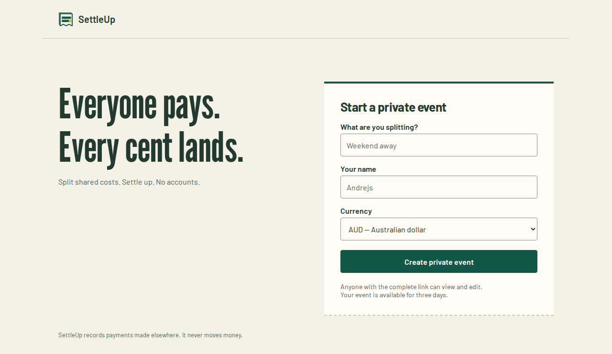
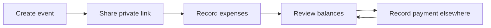

<p align="center">
  
</p>

<h1 align="center">SettleUp</h1>

<p align="center">
  No-login shared expenses for short-lived private-by-link events.
</p>

<p align="center">
  <a href="https://github.com/astrazds/settleup/actions/workflows/ci.yml"></a>
  <a href="LICENSE"></a>
</p>

SettleUp is a mobile-first shared-expense app for trips, weekends, meals, and
parties. One person starts a private event and shares the link. The group
records what everyone paid, sees exactly how each cost was split, and finishes
settling without creating accounts.

The promise is **"Everyone pays. Every cent lands."** SettleUp records
payments made outside the app. It does not move money.

<p align="center">
  
</p>

## Why SettleUp?

Shared costs should not become a spreadsheet or a banking product. SettleUp
keeps one short-lived workspace behind a private link:

- No accounts. The complete event link is the access boundary, so keep it
  private. Anyone with the link can view and edit the event.
- Equal splits only, in integer minor units. Remainder cents are assigned
  deterministically and shown on the expense.
- One next settlement suggestion at a time, derived from the current ledger.
- Links work for three days. Event data becomes eligible for cleanup after
  five days and is deleted by the next startup or hourly cleanup run.

## Install

SettleUp ships as source. [mise](https://mise.jdx.dev/) installs the exact
Node.js and npm versions declared in `mise.toml`.

```sh
git clone https://github.com/astrazds/settleup.git
cd settleup
mise install
mise run install
mise run dev
```

Open `http://127.0.0.1:5173`. The web development server proxies relative
`/api` requests and event streams to the API on port `8787`.

Run either surface separately with `mise run dev:web` or `mise run dev:api`.

## Use

1. Create a private event with a title, your name, and a currency, then share
   the link with the group.
2. Record equal-split expenses as they happen. Inspect the exact per-person
   shares, including remainder cents.
3. Open **Settle** for current balances and the next suggested payment. Record
   the payment after it happens outside SettleUp.
4. Use **People** to add or rename participants. A person referenced by an
   expense or payment cannot be removed.



Expenses can be entered directly on the ledger. Add and edit forms also have direct URLs. Live updates cause the browser
to fetch the latest event snapshot. If the event changes while you edit, your
draft stays visible and saving pauses. Choose **Load latest** to reset the form
to the current event before continuing.

## Privacy

SettleUp has no accounts, analytics, or advertising. The server does store
event titles, participant names, expenses, and recorded payments for the event
lifetime. Event tokens are stored as hashes. Anyone with the complete link can
read and change that data.

| Location | Purpose |
| --- | --- |
| SQLite event rows | Title, currency, participants, expenses, shares, and payments until cleanup |
| Hashed event token | Resolve the private link without storing it in plaintext |
| Tab-session participant ID | Remember the current person in this browser tab |

See [PRIVACY.md](PRIVACY.md) for the complete data boundary.

## Limitations

- Splits are equal only. There are no percentages, weights, or itemized shares.
- SettleUp records payments. It does not transfer money or connect to a bank.
- Event links last three days. This is not a permanent ledger.
- The interface is English-only.
- The realtime broker is process-local, so v1 runs a single API replica.
- There is no hosted demo. Run it locally from this repository.

## Project structure

| Path | Purpose |
| --- | --- |
| `apps/web/` | Static React Router SPA and visual/product contracts |
| `src/server/` | Hono JSON API, SQLite, and SSE invalidation |
| `packages/contracts/` | Zod schemas and TypeScript types for the HTTP boundary |
| `docs/assets/readme/` | README icon and landing screenshot |

Product behavior lives in [`apps/web/PRODUCT.md`](apps/web/PRODUCT.md). The
visual system is [`apps/web/DESIGN.md`](apps/web/DESIGN.md). The API never
serves frontend assets or client routes. See the [architecture map](docs/architecture.md)
for rule ownership, mutation order, browser state, and focused verification.
Contributor setup and test commands live in [CONTRIBUTING.md](CONTRIBUTING.md).
Report vulnerabilities through the process in [SECURITY.md](SECURITY.md).

## HTTP API

See the [HTTP API reference](docs/api.md) for endpoints, request bodies,
status codes, version preconditions, and event streams.

## SQLite, retention, and deploy

See the [deployment guide](docs/deployment.md) for build outputs, API startup,
persistent storage, retention, and reverse proxy requirements.

## Development

Start with the [contributor guide](CONTRIBUTING.md) for setup, verification,
and visual review. The [agent guide](AGENTS.md) links the project rules and
browser driver. See [CI](https://github.com/astrazds/settleup/actions/workflows/ci.yml)
for the checks on pull requests. SettleUp is licensed under [MIT](LICENSE).
